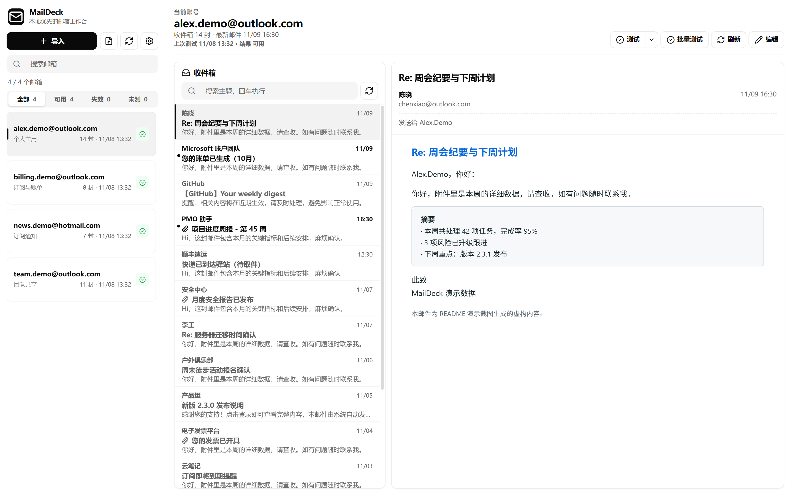
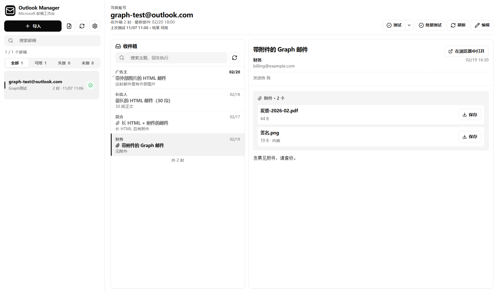
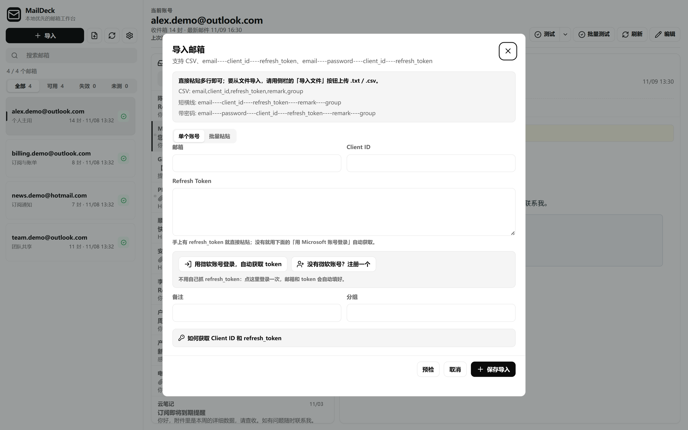
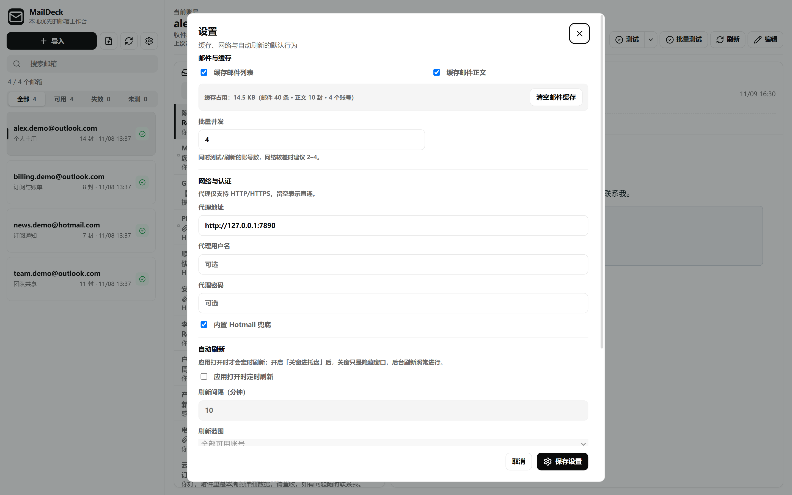

# MailDeck

[](https://github.com/xinghe-labs/maildeck/actions/workflows/verify.yml)
[](https://github.com/xinghe-labs/maildeck/releases)
[](LICENSE)
[](#下载安装)
[](https://nodejs.org)

本地优先的邮箱工作台：账号与邮件缓存在本机，批量导入、连接测试、批量刷新、读信一屏完成。

目前支持 Microsoft 邮箱（Outlook / Hotmail / Live），用于管理**自己拥有或获得授权**的多个邮箱账号（如个人多个备用邮箱、团队共享邮箱、企业租户内批量授权邮箱）。



> **合规提示**：请仅导入你自己拥有或已获得书面授权的账号。批量导入、读取他人账号违反 Microsoft 服务条款，相关责任由使用者自行承担。

## 下载安装

Windows 安装包与绿色版见 [Releases](https://github.com/xinghe-labs/maildeck/releases)：

| 文件 | 说明 |
| --- | --- |
| `MailDeck-Setup-<版本>.exe` | NSIS 安装包，装到本机并创建开始菜单快捷方式 |
| `MailDeck-<版本>-portable.exe` | 绿色版（portable），免安装直接运行 |
| `SHA256SUMS-<版本>.txt` | 上述产物的 SHA-256 校验和 |

### 绿色版怎么用

绿色版是单个 exe，双击就能跑，不写注册表、不建快捷方式。数据仍在 `%APPDATA%\maildeck`（想便携存放就用下面的环境变量换目录）。

```powershell
# 把数据放到 exe 同级的 data 目录，U 盘携带时整个目录一起拷走
$env:MAILDECK_USER_DATA_DIR = "$PSScriptRoot\data"
.\MailDeck-0.3.0-portable.exe
```

### 校验下载完整性

安装包**未做 Authenticode 签名**，首次运行时 Windows SmartScreen 可能提示「已保护你的电脑」，需要点「更多信息 → 仍要运行」。因为签名缺失，下载后请务必自己核对 SHA-256（`certutil` 每个 Windows 都有，不依赖 PowerShell 模块）：

```cmd
:: 1. 算出下载文件的哈希
certutil -hashfile MailDeck-Setup-0.3.0.exe SHA256

:: 2. 打开 SHA256SUMS-0.3.0.txt，比对应那一行
type SHA256SUMS-0.3.0.txt
```

两串 64 位十六进制完全一致才说明文件没有被替换或损坏；不一致就不要运行。想一次校验全部产物（PowerShell）：

```powershell
Get-Content .\SHA256SUMS-0.3.0.txt | ForEach-Object {
  $expected, $name = $_ -split '\s+', 2
  $name = $name.Trim().TrimStart('*')
  $actual = ((certutil -hashfile $name SHA256)[1] -replace '\s', '')
  "{0}  {1}" -f ($(if ($actual -eq $expected.ToUpper()) { "OK  " } else { "FAIL" })), $name
}
```

账号可以直接在应用里登录获取 token（设备代码授权，不用自己抓包），也可以自己粘 `refresh_token`：

- **没有 token**：导入弹窗里点「用 Microsoft 账号登录」→ 浏览器打开 `https://login.microsoft.com/device` 输入页面上的 8 位代码 → 登录完回到应用，邮箱、client_id、refresh_token 自动填好。
  - 微软提示「未验证的应用」是正常的：这里用的是公开客户端，应用只申请读信权限。
  - 世纪互联等主权云账号可以指向自己的登录端点：启动前设 `MAILDECK_DEVICE_CODE_BASE=https://login.chinacloudapi.cn`。
- **已有 token**：直接粘贴，需要满足：
  - Graph token：`Mail.Read` 或等价读取权限。
  - Outlook IMAP token：`https://outlook.office.com/IMAP.AccessAsUser.All` 等邮件读取权限。

应用会根据 token 返回的 scope 自动选择 Graph 或 IMAP 读取路径。

## 功能

- 导入邮箱账号：支持 CSV、`email----client_id----refresh_token`、`email----password----client_id----refresh_token`
- 内置设备代码登录：不用自己抓 `refresh_token`，登录一次就自动填好
- 自动识别 Microsoft Graph / Outlook IMAP OAuth token
- 测试连接、批量测试、批量刷新收件箱
- 读取邮件列表和邮件正文
- 按主题搜索邮件
- 加载更多邮件
- 编辑已导入账号
- 导入前预检有效行、重复行、错误行、字段顺序和 token 类型
- 展示最近刷新时间、收件箱数量和最新邮件时间
- 本地缓存最近邮件，切换邮箱时优先显示缓存
- 批量测试和批量刷新使用并发队列并显示进度
- 支持在设置中调整批量任务并发数
- 批量测试和批量刷新支持取消
- 批量刷新失败后可单独重试失败账号
- 支持关闭邮件列表/正文缓存
- 支持 HTTP/HTTPS 代理配置；SOCKS 暂不启用，以避免部分邮件传输绕过代理
- 本地加密保存 refresh token
- 使用本机 SQLite 保存账号和邮件缓存

## 截图

| 读信与附件 | 导入账号 |
| --- | --- |
|  |  |



- **读信**：正文按内容高度自适应（只留一条滚动条），外部图片默认拦截并可一键显示；附件可逐个「保存到…」，也可直接跳「在浏览器中打开」。
- **导入**：支持单账号表单与批量粘贴/文件导入，导入前预检有效行、重复行、token 类型；重复导入会要求确认覆盖。
- **设置**：缓存开关与占用、批量并发、HTTP/HTTPS 代理、内置 Hotmail 兜底、定时刷新。

## 开发运行

需要 Node.js `22.12.0` 或更高版本。`npm install` 会显式下载并校验当前锁定的 Electron 二进制；网络受限环境可通过 Electron 支持的 `ELECTRON_MIRROR` 环境变量配置下载源。

默认下载源是 GitHub releases。部分网络下该域名会被限速到十几 KB/s，导致 `npm install` 在 `electron:install` 阶段长时间无进展（缓存目录不增长）。此时改用镜像：

```powershell
$env:ELECTRON_MIRROR = "https://npmmirror.com/mirrors/electron/"
npm install
```

```powershell
npm install
npm run dev
```

构建 Windows 安装包/绿色版：

```powershell
.\scripts\package-windows-local.ps1
```

该脚本优先复用 `node_modules\electron\dist` 中已安装并校验版本的 Electron，随后执行图标生成、生产构建、portable/NSIS 打包和发布启动烟测；仅在本地 Electron 缺失时才运行下载。`npm run dist:win` 仍可作为标准在线构建入口。

当前 Windows 产物**未做 Authenticode 签名**，首次运行可能出现 SmartScreen 提示；签名需要单独配置生产证书。

## 验证

```powershell
npm run verify
```

`verify` 依次执行三项门禁，与 CI（`.github/workflows/verify.yml`）完全一致：

1. `npm run typecheck` —— 分别检查渲染进程、主进程和测试三套 tsconfig。测试代码也在类型检查范围内。
2. `npm run lint` —— ESLint 扁平配置，启用类型感知规则，包括 `no-floating-promises` 和 `no-misused-promises`。
3. `npm test` —— Vitest 全量用例。

CI 还会运行 `npm audit --omit=dev`，确保随应用发布的依赖没有已知漏洞。

## 技术栈

| 层 | 选型 |
| --- | --- |
| 桌面壳 | Electron（主进程 `electron/main`，预加载 `electron/preload`，IPC 契约 `electron/shared`） |
| 渲染层 | React 19 + TypeScript + Vite，无 UI 框架，样式为手写 CSS |
| 邮件协议 | Microsoft Graph（`undici`）、IMAP（`imapflow`）、`mailparser` / `@zone-eu/mailsplit` 解析 MIME |
| 安全 | `safeStorage` 加密 refresh_token、`dompurify` 清洗邮件 HTML、CSP + 外部图片拦截 |
| 存储 | 本机 SQLite（WAL），无需单独安装数据库 |
| 测试 | Vitest（jsdom 组件测试 + 主进程单元测试），84 个测试文件 / 509 个用例 |

## 项目结构

```text
electron/
  main/       主进程：Graph/IMAP 客户端、凭据加密、SQLite 存储、IPC 处理器、代理
  preload/    contextBridge 暴露的 window.maildeck
  shared/     主进程与渲染层共用的 IPC 契约、错误码、URL 白名单
src/
  components/ 侧栏、邮件列表、阅读器、导入/设置弹窗、错误横幅等
  *.ts        会话状态机、分页、HTML 清洗、表单校验、列宽拖拽、已读痕迹
tests/        84 个 Vitest 用例文件（每个用户可见行为都有对应断言）
scripts/      图标生成、Windows 打包与发布脚本
docs/         开发计划与截图
```

## 数据与隐私

账号和邮件缓存保存在本机 `maildeck.db` SQLite 文件中，不上传到任何第三方服务。从旧版本（Outlook Manager）升级时，`%APPDATA%\outlook-manager` 整个目录会自动改名为 `%APPDATA%\maildeck`，旧库文件也会就地改成 `maildeck.db`，账号不用重新导入。更早的 `accounts.json` 和 `mail-cache.json` 会在首次启动时自动迁移，迁移后保留备份。应用不需要用户单独安装 SQLite。

`refresh_token` 通过 Electron `safeStorage`（Windows DPAPI）加密后落盘；数据目录被拷贝到另一台机器或换了 Windows 用户后无法解密，此时应用会提示「凭据无法解密，请编辑账号重新填写 refresh_token」。

邮件摘要和已打开正文默认缓存 5 分钟。需要立即读取服务器最新邮件时，可使用邮件列表右上角的强制刷新按钮。

邮件正文中的外部图片默认被拦截（不发起任何请求，也不保留远程地址），需要时点「显示图片」加载。

## 已知限制

- **仅支持 Windows**：打包脚本与图标流程面向 Windows，未适配 macOS / Linux。
- **登录用的是公共客户端**：设备代码登录走微软的公开 client_id（`Microsoft Graph PowerShell`），不能自定义权限或应用名；要自己的应用注册请用「粘贴 refresh_token」路径。
- **主权云需要手动指端点**：世纪互联/其它云需设 `MAILDECK_DEVICE_CODE_BASE`。
- **SOCKS 代理未启用**：只支持 HTTP/HTTPS 代理。
- **附件只在 Graph 路径下可下载**：走 IMAP 兜底的账号，应用内看不到附件，需用「网页版」入口查看。
- **大账号首次刷新较慢**：单账号首次拉取受微软接口限制，8 秒左右属正常；列表会显示已等待秒数，30 秒超时并给出失败原因。
- **产物未签名**：没有 Authenticode 证书，SmartScreen 会提示。

## 导入格式

应用解析以下两种文本格式（字段以 `----` 分隔或 CSV 列），导入前会预检有效行、重复行、错误行、字段顺序和 token 类型：

```text
email,client_id,refresh_token,remark,group
```

```text
email----client_id----refresh_token----remark----group
email----password----client_id----refresh_token
```

四字段格式中的 `password` 只用于识别字段顺序（通过第二列是否为 UUID 判断 client_id 位置），**不会被读取或保存**。

## 注意

应用启动时持有单实例锁：重复启动第二个实例会自动退出并聚焦已有窗口，避免两个进程同时写入 SQLite 数据库导致数据损坏。使用 `MAILDECK_USER_DATA_DIR`（兼容旧名 `OUTLOOK_MANAGER_USER_DATA_DIR`）指定不同数据目录的实例互不影响。

批量刷新会优先做增量读取：IMAP 使用上次最高 UID，Graph 使用上次最新邮件时间。首次刷新或没有游标时会读取最近邮件。

批量测试和批量刷新默认 4 并发，可在设置中调整为 1-12。账号量较大或网络不稳定时建议保持 4-6，代理质量较好时可适当调高。

## 贡献

提交前请跑一遍 `npm run verify`（与 CI 同一条门禁）。行为变更请同时补测试：仓库里每个用户可见行为都有对应的 Vitest 断言。

## 许可证

[MIT](LICENSE) © 2026 予星河
